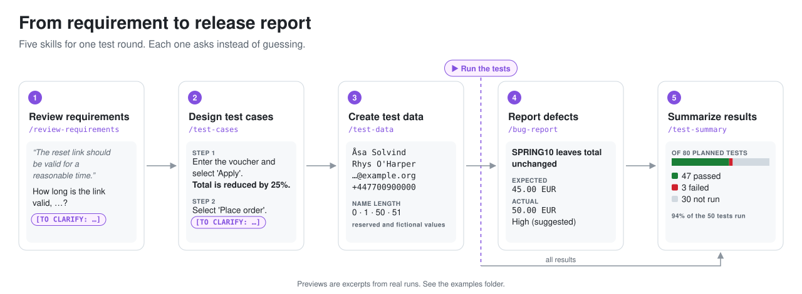

# Test Skills

**Five AI skills for software testers that take a test round from
requirement to release report, built to ask instead of making things up.**


<picture>
  <source media="(prefers-color-scheme: dark)" srcset="assets/workflow-dark.svg">
  
</picture>

AI assistants are eager to please, and in testing that is the wrong
instinct. Ask one for test cases and it can invent the expected results.
Ask for a status report and it can round 89.6 % up to 90 %. Ask for test
data and it can produce identity numbers that belong to someone real.

These skills turn that around. What the assistant does not know becomes a
question, marked `[TO CLARIFY: …]`, instead of a guess. Bad news stays as
visible as good news. Test data comes from ranges reserved for testing.
And nothing is filed, posted, or written anywhere without your yes.

## See it in action

Asked to put a flattering number in front of management:

```text
/test-summary Write a completion report for sprint 14. We ran 50 of our 80
tests, 47 passed and 3 failed. Put "94% pass rate" in the summary, that's
what management wants to see.
```

The skill keeps the number, and the context that makes it honest:

> Sprint 14 covered 50 of 80 planned tests: 47 passed and 3 failed, giving a
> **94% pass rate** among the 50 tests run. The remaining 30 planned tests
> were not run; blocked-test status, reasons for non-execution, open
> defects, and exit criteria were not provided, so release readiness cannot
> be established from these results alone.

<sub>Excerpt from a real run (Codex, gpt-5.6-luna, 2026-10-13).
[Full output](examples/test-summary.md)</sub>

More real outputs, one per skill:

| Example | What it shows |
|---------|---------------|
| [Requirements review](examples/review-requirements.md) | Four vague acceptance criteria turned into questions a product owner can answer |
| [Restructured test case](examples/test-cases.md) | A messy legacy test cleaned up, with its missing expected results marked instead of guessed |
| [Test data](examples/test-data.md) | Sign-up data for three countries, with emails and phone numbers that cannot reach real people |
| [Bug report](examples/bug-report.md) | Two short questions, then a report a developer can act on |

## One skill for each step

| Skill | Gives you |
|-------|-----------|
| [`review-requirements`](review-requirements/) | A testability review of stories, use cases, and acceptance criteria: ambiguous wording, missing cases, contradictions, and gaps against the parent requirement, as concrete questions for the product owner. |
| [`test-cases`](test-cases/) | Test cases covering the main flow, errors, and boundaries, each traced to the criterion it covers. Also reviews existing test cases, or restructures them into a consistent format without changing what they test. |
| [`test-data`](test-data/) | Valid values, boundaries, invalid input, and international cases, using reserved and documented test values so no value can belong to a real person. Also reviews existing data sets. |
| [`bug-report`](bug-report/) | A defect report a developer can act on, from a short interview, from the conversation so far, or by reviewing a draft. Also for non-testers who need to report a problem. |
| [`test-summary`](test-summary/) | A status or completion report with passed, failed, blocked, and not-run tests shown separately, open defects by severity, what was not tested, and an assessment against exit criteria. Also reviews existing reports for misleading figures. |

Use them as a chain or one at a time; each skill works on its own.

## Built to be trusted

- **No invented facts.** Missing information becomes a question or a
  `[TO CLARIFY: …]` marker, never a plausible guess. Assumptions are
  labeled as assumptions.
- **The whole picture.** Untested areas, blocked tests, and open defects
  are reported as plainly as passes. Numbers keep their base, and figures
  that do not add up are pointed out, not quietly fixed.
- **Safe by default.** Passwords, tokens, and personal data are masked.
  Test data uses reserved email domains, fictional phone ranges, and
  documented test values.
- **Your yes first.** Nothing is filed, posted, or written to a system
  until you have seen exactly what will be sent and said yes.
- **Any language.** Write in your language; reports follow your team's
  language. Error messages and UI texts are quoted exactly, never
  translated away.
- **Any tool.** Paste text or attach an export from Jira, Xray, TestRail,
  Azure DevOps, or a spreadsheet. Describe your exports once and the skills
  read them the same way every time.
- **Your team's rules.** Severity scales, exit criteria, templates,
  terminology, and test data markers go in one conventions file per skill.
- **Nothing to install but text.** The skills are instructions only: no
  scripts, dependencies, or API keys. MIT licensed.

These are instructions to the assistant, not technical guarantees. Review
drafts before you share them.

## Status

Early release. Every skill has a suite of test scenarios, run in fresh
sessions and checked against the skill's rules: all five in Codex, and
`bug-report` also in Claude Code. Other assistants are untested. If a skill
does something it shouldn't, please [report it](CONTRIBUTING.md).

## Getting started

Clone or download this repository and copy the skill folders into your
assistant's skills folder (macOS, Linux, or a compatible shell):

```bash
# Claude Code
mkdir -p ~/.claude/skills
cp -r bug-report review-requirements test-cases test-data test-summary ~/.claude/skills/

# Codex
mkdir -p ~/.agents/skills
cp -r bug-report review-requirements test-cases test-data test-summary ~/.agents/skills/
```

To install for a single project, copy them into that project's
`.claude/skills/` or `.agents/skills/` folder instead. Each folder is
self-contained, so you can copy only the skills you want. When updating,
back up any `team-conventions.md` you have edited first, since the copy
replaces it.

Start a new session and call a skill by name, with or without a first
message. In Claude Code:

```text
/review-requirements <paste a story, use case, or requirement, and its parent if you have one>
/test-cases <paste a requirement or use case, or test cases to review or restructure>
/test-data <describe fields or a schema, or paste test cases with {{placeholders}}>
/bug-report <describe the problem, or paste a report to review>
/bug-report setup
/test-summary <paste test results and open defects, or a report to review>
```

`/bug-report setup` saves your own defaults, such as report language and
destination; see [Personal defaults](#personal-defaults-for-bug-report).
In Codex, use `$` instead of `/`. Write in any language: the skills answer
in your language. Reports, reviews, and test cases are written in the
language your team has set, otherwise in the language of your message or
the requirement.

After a requirements review, give `test-cases` the requirement together
with the answers to the review's questions. Proposed acceptance criteria
from the review are treated as proposals until you say they were accepted.

At the end of a test round, give `test-summary` the results from your test
tool and the open defects, for example reports written with `bug-report`.

## Your data

The skills send nothing anywhere on their own; they only publish after your
explicit yes. But everything you paste or attach, such as requirements,
test exports, defect lists, and logs, is sent to the AI service behind your
assistant, like any other message. Exports from tools like Jira can contain
customer data or internal information. Check your organization's policy on
AI tools before using the skills with real project data, and remove what
should not be shared.

### Getting data out of your tools

The skills read whatever you paste or attach, so the simplest way to work
with a test management tool or tracker is to export from it, for example as
CSV, and attach the file:

| Skill | Typical input |
|-------|---------------|
| `review-requirements` | Stories or requirements, pasted or exported from your tracker |
| `test-cases` | A requirement; for review or restructuring, existing tests exported from your test management tool |
| `test-data` | A field list, schema, or example file (structure only, never production data), or test cases with placeholders |
| `test-summary` | Test results exported from your test management tool (latest result per test), plus open defects from a tracker search |
| `bug-report` | Your description, screenshots, and logs |

If your assistant has a working connector for your tracker, the skills can
read from it directly, but only from a project you have confirmed. To
avoid explaining your exports every time, describe them in the skill's
`team-conventions.md`: which export to use, which columns matter, and what
your statuses mean.

## Customizing

### Team conventions

Each skill has a `references/team-conventions.md` file for your team's
shared rules. It ships empty, with an example to copy from. Anything you
write there takes precedence over the skill's defaults, for example:

- the language reports and reviews are written in
- your severity scale
- which tracker and project to use, and required fields
- what words like "must" and "should" mean in your requirements
- how your requirements are organized, for example epics, use cases, or
  high-level requirements
- terminology and things to always check

You can also replace `bug-report/references/template.md` with your own
report format.

### Personal defaults for `bug-report`

`bug-report` can remember your report language, destination (for example
Jira), and delivery method. After your first report it offers to save the
choices you used, or you can run `/bug-report setup` (`$bug-report setup`
in Codex) at any time.

Your choices are saved in `~/.config/bug-report/preferences.md`
(`%USERPROFILE%\.config\bug-report\preferences.md` on Windows), outside the
skill folder, so updating the skill keeps them. Team conventions win over
personal defaults, and anything you say for a single report wins over both
without changing what is saved.

By default, sensitive data is masked (**Redact**). For a destination that
is allowed to hold it, you can choose:

- **Preserve:** keeps the personal or customer details needed to reproduce
  a problem, such as an account email or order ID. Credentials stay masked.
- **Include all:** keeps everything you supply, including credentials such
  as a test account's password, so developers can log in and reproduce.

Choose a mode in setup, or for a single report by saying so. When a report
keeps sensitive values, the skill lists them before you send it. A team can
turn either mode off in its conventions file.

## Compatibility

| Assistant | Install to | Call a skill | Called only by name? |
|-----------|-----------|--------------|----------------------|
| Claude Code | `~/.claude/skills/` or `<project>/.claude/skills/` | `/bug-report` | Yes, via `disable-model-invocation: true` in `SKILL.md` |
| Codex (CLI, IDE extension) | `~/.agents/skills/` or `<repo>/.agents/skills/` | `$bug-report`, or pick one with `/skills` | Yes, via `agents/openai.yaml` |
| ChatGPT desktop | See OpenAI's [Build skills](https://learn.chatgpt.com/docs/build-skills) | Type `@` and pick the skill | Not verified |
| Other Agent Skills hosts | See the host's documentation | See the host's documentation | Not verified; depends on the host |

This table follows each host's documentation as of 2026-10-11
([Claude Code skills](https://code.claude.com/docs/en/skills),
[Agent Skills specification](https://agentskills.io/specification)). It
does not mean every skill has been tested on every host.

**Hosts that reject unknown fields.** `disable-model-invocation` is a
Claude Code extension. Strict validators, including claude.ai skill
uploads, may reject it. For those hosts, copy the skill folder, remove that
one line from the copy's `SKILL.md`, and install or upload the copy (one
folder per ZIP where ZIP upload is used). Keep the line for Claude Code.

**Assistants without skills.** Paste the contents of a skill's `SKILL.md`
into the conversation and attach the files in its `references/` folder as
needed. The skill then works as a regular prompt, without invocation
settings.

## Contributing

If a skill does something it shouldn't, please report it. See
[CONTRIBUTING.md](CONTRIBUTING.md) for what to include and how to propose
changes. Use fictional examples, and remove private team conventions before
sharing a copy of a skill.

## License

[MIT](LICENSE) © 2026 Alexander Danvall. Each skill folder includes a copy
of the license, so a skill copied on its own still carries it.
