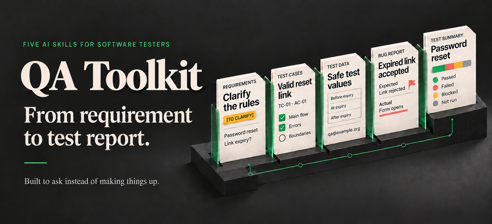

# QA Toolkit



AI skills for software testers—built to ask instead of making things up.

Install the five skills and the `team-setup` helper as the **QA Toolkit**
plugin (`qa-toolkit`), or copy individual skill folders for local use.


AI assistants already write tidy, well-structured test reports. What they
still get wrong are the details that matter in testing. Asked to clean up
an old test case, they fill in the expected results nobody wrote down.
Asked for test data, they produce identity numbers and email addresses that
can belong to real people. Asked for a summary, they make the release call
for you. And every tester on the team gets a different format, severity
scale, and language.

QA Toolkit gives your assistant two things:

- **Tested rules for testing work.** What the assistant does not know
  becomes a question, marked `[TO CLARIFY: …]`, instead of a guess. Test
  data comes from ranges reserved for testing. Bad news stays as visible
  as good news. Nothing is filed, posted, or written anywhere without your
  yes.
- **One place for your team's rules.** Your tracker, severity scale, exit
  criteria, and language go in one file. All five skills read it, in Claude
  Code and in Codex, so nobody repeats the rules in every request.

## See it in action

### One team file, two skills

The team's conventions file, written once:

```markdown
## General
- Reports are written in English.
- Tracker: Jira, project SHOP. Test management: Xray.
- Severity: S1 (production down or data loss), S2 (major function broken,
  no workaround), S3 (impaired, workaround exists), S4 (cosmetic).

## bug-report
- Component is required: Checkout, Search, Account, or Admin.
- Name the Xray test the bug was found with, if any.

## test-summary
- Exit criteria for release testing: all P1 tests run; no open S1 or S2
  defects.
- Recommendation terms: Go / Go with accepted risks / No-go. The release
  manager decides.
```

A tester reports a bug, without mentioning any of it:

```text
/bug-report Checkout in the test environment, build 3.4.1, Chrome 130 on
Windows 11. Logged in as the standard test user, added one item (SKU-1001,
50.00 EUR), entered the voucher WINTER25 and pressed Apply. The total
became 25.00 EUR instead of 37.50 EUR, so the 25 % discount is applied
twice. Every time, also with SKU-2002. Found while running Xray test
SHOP-T104.
```

> Using `.qa-toolkit/conventions.md` for English, Jira project SHOP, and
> the team severity scale. […]
>
> **Title**
>
> Checkout – WINTER25 reduces 50.00 EUR total to 25.00 EUR instead of
> 37.50 EUR
>
> […]
>
> - Component: Checkout
> - […]
> - Xray test: SHOP-T104
>
> […]
>
> **Severity**
>
> [TO CLARIFY: severity under the team scale; workaround availability is
> unknown]. The observed impact is an incorrect checkout total.

The team's scale separates S2 from S3 by whether a workaround exists, so
the skill asks instead of guessing. Once the bug is filed as SHOP-931 at
S2, the release summary judges it against the same team's exit criteria:

> Of 20 planned tests, 17 passed, 1 failed, 1 was blocked, and 1 was not
> run. Both release exit criteria are **not met**: P1 test SHOP-T111
> remains TODO, and S2 defect SHOP-931 remains Open. **Proposed
> recommendation: No-go**, for the release manager to confirm.
>
> | Criterion | Assessment | Evidence |
> |-----------|------------|----------|
> | All P1 tests run | Not met | 11 of 12 run; SHOP-T111 is TODO |
> | No open S1 or S2 defects | Not met | SHOP-931 is S2, Open |

<sub>Excerpts from a real run (Codex, gpt-6.1-sol, medium effort, 0.3.0
skills, 2026-10-21; scenario TM-16, run 2 of 3, all three passed).
[Full output](examples/team-conventions.md)</sub>

### What the built-in rules stop

Asked to restructure a legacy test whose last two steps have no expected
result (`Step 3: Press 'Place order'`, `Step 4: Check
ORDERS.VOUCHER_CODE`), the same model without the skill fills them in:

> | Step | Action | Expected result |
> |---|---|---|
> | 5 | Find the created order in `ORDERS` using the recorded order ID. Check `VOUCHER_CODE`. | `ORDERS.VOUCHER_CODE` equals `WINTER25`. |

With the skill, the gap stays visible, and the test is marked blocked
until someone who knows answers:

> | # | Action | Data | Expected result | Original step |
> |---|---|---|---|---|
> | 4 | Check `ORDERS.VOUCHER_CODE` for this order. | — | [TO CLARIFY: expected stored value] | 4 |

<sub>Scenario TC-11 (Codex, gpt-6.1-sol, medium effort; with the 0.3.0
skills on 2026-10-19 and without them on 2026-10-20).
[Full output](examples/test-cases.md)</sub>

More real outputs, one per skill, each with what the same model did
without the skill:

| Example | What it shows |
|---------|---------------|
| [Requirements review](examples/review-requirements.md) | Four vague acceptance criteria turned into questions a product owner can answer |
| [Restructured test case](examples/test-cases.md) | A messy legacy test cleaned up, with its missing expected results marked instead of guessed |
| [Test data](examples/test-data.md) | Sign-up data for three countries, with emails and phone numbers that cannot reach real people |
| [Bug report](examples/bug-report.md) | A report a developer can act on right away, with only what is missing asked at the end |
| [Test summary](examples/test-summary.md) | A "94 % pass rate" management asked for, kept next to the 30 tests that never ran |
| [One team file, two skills](examples/team-conventions.md) | The bug report and release summary above, in full |

## One skill for each step

| Skill | Gives you |
|:-----:|-----------|
| [`review-requirements`](skills/review-requirements/) | A testability review of stories, use cases, and acceptance criteria: ambiguous wording, missing cases, contradictions, and gaps against the parent requirement, as concrete questions for the product owner. |
| [`test-cases`](skills/test-cases/) | Test cases covering the main flow, errors, and boundaries, each traced to the criterion it covers. Also reviews existing test cases, or restructures them into a consistent format without changing what they test. |
| [`test-data`](skills/test-data/) | Valid values, boundaries, invalid input, and international cases, using reserved and documented test values for contact, payment, and identity details, with invented names and addresses labeled as fictional. Also reviews existing data sets. |
| [`bug-report`](skills/bug-report/) | A defect report a developer can act on, from a short interview, from the conversation so far, or by reviewing a draft. Also for non-testers who need to report a problem. |
| [`test-summary`](skills/test-summary/) | A status or completion report with passed, failed, blocked, and not-run tests shown separately, open defects by severity, what was not tested, and an assessment against exit criteria. Also reviews existing reports for misleading figures. |

Plus one helper: [`team-setup`](skills/team-setup/) writes your team's
shared conventions file, so every skill uses the same languages, tracker,
severity scale, and rules. See [Team conventions](#team-conventions).

Use them as a chain or one at a time; each skill works on its own.

## Built to be trusted

- **No invented facts.** Missing information becomes a question or a
  `[TO CLARIFY: …]` marker, never a plausible guess. Assumptions are
  labeled as assumptions.
- **The whole picture.** Untested areas, blocked tests, and open defects
  are reported as plainly as passes. Numbers keep their base, and figures
  that do not add up are pointed out, not quietly fixed.
- **Safe by default.** Passwords, tokens, and personal data are masked.
  Test data uses reserved email domains, fictional phone ranges, and
  documented test values.
- **Your yes first.** Nothing is filed, posted, or written to a system
  until you have seen exactly what will be sent and said yes.
- **Any language.** Write in your language; reports follow your team's
  language. Error messages and UI texts are quoted exactly, never
  translated away.
- **Any tool.** Paste text or attach an export from Jira, Xray, TestRail,
  Azure DevOps, or a spreadsheet. Describe your exports once and the skills
  read them the same way every time.
- **Your team's rules.** Severity scales, exit criteria, required fields,
  terminology, and test data markers go in one conventions file that every
  skill reads. See [Team conventions](#team-conventions).
- **Nothing to install but text.** The skills are instructions only: no
  scripts, dependencies, or API keys. MIT licensed.

These are instructions to the assistant, not technical guarantees. Review
drafts before you share them.

## Tested across models

The skills are tested with 179 scenarios: 104 regular scenarios the skills
are improved against, and 75 *held-out* scenarios, kept apart from that
work, that check whether the rules also work on cases they were not
written for. They cover vague and complete input, missing information,
eight languages, fictional passwords and personal data, team conventions,
tool exports, and requests that push the skill to round up a number or
guess a value. Every run starts in a fresh session and is checked against
the scenario's requirements, by script where possible and by reading.

Two models in Codex ran every scenario with the released 0.3.0 skills and
again with no skill installed. On the 145 scenarios that need neither the
team's conventions nor `team-setup`, counting wrong values, boundaries,
behavior, and leaks, and ignoring the skills' own format:

| Model in Codex | Scenarios with a problem, with skills | Without skills | Sensitive values leaked, with / without |
|----------------|---------------------------------------|----------------|------------------------------------------|
| GPT-6.1-Sol, medium effort | 4 | 37 | 0 / 1 |
| GPT-6-Luna, max effort | 12 | 43 | 0 / 4 |

Without the skills, both models write well-structured reports and keep
headline numbers in context. What they get wrong is test data that can
reach real people, expected results and reports invented from nothing,
and acting or deciding for the user. With the skills, no run leaked a
sensitive value or filed anything without a yes.

Team rules written by hand into `AGENTS.md` work almost as well as the
conventions file: plain GPT-6.1-Sol applied them in 16 of 18 scenarios.
What `AGENTS.md` does not give you is the skills' own rules, the same file
for Claude Code and Codex, and `team-setup` asking what a team needs to
decide. One known limit: in Codex, a user's explicit request can win over
a team's ban on a kind of data, such as customer names. See
[Sensitive data in bug reports](#sensitive-data-in-bug-reports) for the
fix.

Claude Sonnet 5.5 in Claude Code ran all scenarios once on an earlier build
of this version, with no leak, nothing filed without a yes, and no invented
test value; its misses were about judgment. Per-skill results, every known
miss, and all runs, runners, and checkers are in
[`tests/README.md`](tests/README.md); they are not part of the plugin
packages.

**Status:** early release. Other assistants are untested. If a skill does
something it shouldn't, please [report it](CONTRIBUTING.md).

## Getting started

### Install the Claude Code plugin

From a local checkout, run:

```bash
claude plugin marketplace add .
claude plugin install qa-toolkit@qa-toolkit-marketplace
```

After this packaging revision is pushed to GitHub, install from a Claude
Code session with:

```text
/plugin marketplace add alexpalexpinne/qa-toolkit
/plugin install qa-toolkit@qa-toolkit-marketplace
```

Claude Code 2.1.275 or later also supports the one-step install:

```text
/plugin install qa-toolkit --marketplace alexpalexpinne/qa-toolkit
```

Plugin skills use the package name as a prefix:

```text
/qa-toolkit:review-requirements <paste a requirement>
/qa-toolkit:test-cases <paste a requirement or existing test cases>
/qa-toolkit:test-data <describe fields or a schema>
/qa-toolkit:bug-report <describe the problem>
/qa-toolkit:test-summary <paste results and open defects>
/qa-toolkit:team-setup
```

### Install in Codex or ChatGPT desktop

This checkout includes an OpenAI repo marketplace at
`.agents/plugins/marketplace.json`. In a recent Codex CLI, run:

```bash
codex plugin marketplace add .
codex plugin add qa-toolkit@qa-toolkit-marketplace
```

In the ChatGPT desktop app, open this repository, restart the app, and
select **QA Toolkit** as a local source in the Plugins Directory. Install
the plugin and test it in a new chat. Use the plugin or skill picker to
invoke a workflow; installed names can include the plugin prefix.

Public directory publication is a separate step. This repository includes
the package files for submission, and makes no claim of an approved public
listing. See OpenAI's [packaging guide](https://developers.openai.com/plugins/build/plugins)
and [submission guide](https://developers.openai.com/plugins/deploy/submission).

### Install individual skills

Clone or download this repository and copy the skill folders into your
assistant's skills folder (macOS, Linux, or a compatible shell):

```bash
# Claude Code
mkdir -p ~/.claude/skills
cp -r skills/* ~/.claude/skills/

# Codex
mkdir -p ~/.agents/skills
cp -r skills/* ~/.agents/skills/
```

To install for a single project, copy them into that project's
`.claude/skills/` or `.agents/skills/` folder instead. Each folder is
self-contained, so you can copy only the skills you want. When updating,
back up any `team-conventions.md` you have edited first, since the copy
replaces it.

Start a new session and call a skill by name, with or without a first
message. The examples and recorded outputs in this repository use these
standalone skill names. In Claude Code:

```text
/review-requirements <paste a story, use case, or requirement, and its parent if you have one>
/test-cases <paste a requirement or use case, or test cases to review or restructure>
/test-data <describe fields or a schema, or paste test cases with {{placeholders}}>
/bug-report <describe the problem, or paste a report to review>
/test-summary <paste test results and open defects, or a report to review>
/team-setup
```

In Codex, use `$` instead of `/`. Write in any language: the skills answer
in your language. Reports, reviews, and test cases are written in the
language your team has set, otherwise in the language of your message or
the requirement.

After a requirements review, give `test-cases` the requirement together
with the answers to the review's questions. Proposed acceptance criteria
from the review are treated as proposals until you say they were accepted.

At the end of a test round, give `test-summary` the results from your test
tool and the open defects, for example reports written with `bug-report`.

## Your data

See the [privacy notice](PRIVACY.md) for processing, storage, and support
disclosures, and the [terms of use](TERMS.md) for the license, the lack of
warranty, and your responsibility for reviewing outputs.

The skills send nothing anywhere on their own; they only publish after your
explicit yes. But everything you paste or attach, such as requirements,
test exports, defect lists, and logs, is sent to the AI service behind your
assistant, like any other message. Exports from tools like Jira can contain
customer data or internal information. Check your organization's policy on
AI tools before using the skills with real project data, and remove what
should not be shared.

### Getting data out of your tools

The skills read whatever you paste or attach, so the simplest way to work
with a test management tool or tracker is to export from it, for example as
CSV, and attach the file:

| Skill | Typical input |
|-------|---------------|
| `review-requirements` | Stories or requirements, pasted or exported from your tracker |
| `test-cases` | A requirement; for review or restructuring, existing tests exported from your test management tool |
| `test-data` | A field list, schema, or example file (structure only, never production data), or test cases with placeholders |
| `test-summary` | Test results exported from your test management tool (latest result per test), plus open defects from a tracker search |
| `bug-report` | Your description, screenshots, and logs |

If your assistant has a working connector for your tracker, the skills can
read from it directly, but only from a project you have confirmed. To
avoid explaining your exports every time, describe them in the skill's
`team-conventions.md`: which export to use, which columns matter, and what
your statuses mean.

## Customizing

### Team conventions

Give the whole team the same rules with one file in your project,
`.qa-toolkit/conventions.md`. There are three ways to create it:

- **Run `team-setup`** (`/qa-toolkit:team-setup` with the plugin). It asks a
  few questions at a time, first about languages, tracker, and severity
  scale, then only about the skills your team uses. It shows the whole file
  and writes it only after you say yes. Run it again to change something.
- **Accept the offer while working.** When a skill notices you stating rules
  a team would decide once, such as the report language or severity scale,
  it offers once, after its result, to save them for the team.
- **Write it by hand** from the
  [template](skills/team-setup/references/conventions-template.md). An
  empty section means the skill's defaults apply.

The skills never write the file without your approval, and never commit it.

Every skill opens `.qa-toolkit/conventions.md` in the current folder or, in
a repository, at the repository root (it does not search other folders),
reads the *General* section
and its own section, and says which conventions it used. Anything in the
file takes precedence over the skill's defaults, for example:

- the language reports and reviews are written in
- your severity scale
- which tracker and project to use, and required fields
- what words like "must" and "should" mean in your requirements
- how your requirements are organized, for example epics, use cases, or
  high-level requirements
- terminology and things to always check

What you say in the conversation still wins for that task, and the core
rules (no invented facts, protecting sensitive data, confirming before
publishing) always apply.

**Why not `AGENTS.md` or `CLAUDE.md`?** You can put team rules there, and
in testing Codex followed them about as well. The conventions file is
for QA work only, so it stays out of the instructions developers load in
every coding session, and the same file works in Claude Code and Codex.
`team-setup` also knows what to ask: exit criteria, how your test tool's
statuses map to outcomes, and when a report may keep personal data. The
exception is a rule that must never be broken; see the next section.

#### Sharing it with the team

| Where the team works | How everyone gets the file |
|----------------------|----------------------------|
| In a project repository | Commit `.qa-toolkit/conventions.md`. Everyone who pulls has it, and changes go through review like any other change. |
| Without a code repository | Keep the file in a shared team folder, for example `qa-team/.qa-toolkit/conventions.md`, and start your assistant in that folder. |
| claude.ai chat or Cowork | Paste the conventions into a shared claude.ai Project's instructions, or attach the file to the conversation. |
| The whole organization | Fork the plugin, fill in each skill's own `references/team-conventions.md`, and distribute the fork through your organization's marketplace. |

**If you maintain your own copy of the skills,** you can instead edit each
skill's `references/team-conventions.md`, and replace
`skills/bug-report/references/template.md` with your own report format.
Don't do this in a plugin installation: plugins are installed into a cache,
and an update replaces edits made there.

### Sensitive data in bug reports

By default, `bug-report` masks sensitive data (**Redact**). For a
destination that is allowed to hold it, a report can instead use:

- **Preserve:** keeps the personal or customer details needed to reproduce
  a problem, such as an account email or order ID. Credentials stay masked.
- **Include all:** keeps everything you supply, including credentials such
  as a test account's password, so developers can log in and reproduce.

Ask for a mode for a single report by saying so, or set it per destination
in the team conventions (for example "Preserve in Jira SHOP"). A team can
also turn either mode off, for example "Always redact", or ban a kind of
data, such as customer names; the skill is told to follow that rule even
when the user asks to keep the data. This is an instruction, not a
technical control: in testing, Codex sometimes let an explicit request in
the conversation win over a ban on a kind of data (7 of 13 runs).

For a rule like that, also put it in the instructions file your assistant
loads on its own, `AGENTS.md` for Codex or `CLAUDE.md` for Claude Code,
for example "Bug reports never contain customer names or customer numbers,
even if the reporter asks." With the same ban in `AGENTS.md` as well,
Codex kept it in all 10 runs; `CLAUDE.md` has not been tested. If your
team must never have certain data in its tracker, enforce that in the
tracker too. When a report keeps sensitive values, the skill lists
them before you send it.

There are no personal settings to configure. Rules you want every report to
follow, such as the report language or tracker, go in the team conventions
file, which also works for a team of one.

## Compatibility

| Assistant | Install to | Call a skill | Called only by name? |
|-----------|-----------|--------------|----------------------|
| Claude Code | `~/.claude/skills/` or `<project>/.claude/skills/` | `/bug-report` | Yes, via `disable-model-invocation: true` in `SKILL.md` |
| Claude Code plugin | Install `qa-toolkit` from the repository marketplace | `/qa-toolkit:bug-report` | Yes, via the same skill setting |
| Codex (CLI, IDE extension) | `~/.agents/skills/` or `<repo>/.agents/skills/` | `$bug-report`, or pick one with `/skills` | Yes, via `agents/openai.yaml` |
| Codex plugin | Install `qa-toolkit` from the OpenAI repository marketplace | Use the skill picker for the installed name | `allow_implicit_invocation: false` is included |
| ChatGPT desktop | See OpenAI's [Build skills](https://learn.chatgpt.com/docs/build-skills) | Type `@` and pick the skill | Not verified |
| ChatGPT plugin | Local desktop marketplace or an approved public listing | Use the plugin or skill picker | Not verified across ChatGPT surfaces |
| Other Agent Skills hosts | See the host's documentation | See the host's documentation | Not verified; depends on the host |

This table follows each host's documentation as of 2026-10-14
([Claude Code skills](https://code.claude.com/docs/en/skills),
[Agent Skills specification](https://agentskills.io/specification)). It
does not mean every skill has been tested on every host.

**Hosts that reject unknown fields.** `disable-model-invocation` is a
Claude Code extension. Strict validators, including claude.ai skill
uploads, may reject it. For those hosts, copy the skill folder, remove that
one line from the copy's `SKILL.md`, and install or upload the copy (one
folder per ZIP where ZIP upload is used). Keep the line for Claude Code.

**Assistants without skills.** Paste the contents of a skill's `SKILL.md`
into the conversation and attach the files in its `references/` folder as
needed. The skill then works as a regular prompt, without invocation
settings.

## Build release packages

From a source checkout, run the packaging helper with Python 3. It uses only
the standard library:

```bash
python3 scripts/package_plugins.py
```

It creates `dist/qa-toolkit-0.3.0-openai.zip`,
`dist/qa-toolkit-0.3.0-claude.zip`, and `dist/SHA256SUMS`. Each archive
contains all six self-contained skills, their references and licenses,
listing assets, documentation, and examples. The helper excludes local
settings, evaluation files, marketplaces, and repository tooling.

The OpenAI archive uses root `plugin.json` and removes only the
Claude-specific `disable-model-invocation` frontmatter line from its skill
copies. Its `agents/openai.yaml` invocation policies remain intact. The
Claude archive uses `.claude-plugin/plugin.json` and preserves that line.
The maintained sources under `skills/` are shared by both builds.

Push the packaging revision to GitHub so the listing's documentation,
support, and privacy links are available. Upload the OpenAI ZIP through the
[plugin submission portal](https://platform.openai.com/plugins).
Resolve its metadata and skill scan findings, complete publisher
verification and review, and publish when approved. Claude publication is
separate; see [Publish a plugin](https://code.claude.com/docs/en/plugins/publish).
Public-directory behavior and approval require testing on the target
platforms.

## Contributing

If a skill does something it shouldn't, please report it. See
[CONTRIBUTING.md](CONTRIBUTING.md) for what to include and how to propose
changes. Use fictional examples, and remove private team conventions before
sharing a copy of a skill.

## License

[MIT](LICENSE) © 2026 Alexander Danvall. Each skill folder includes a copy
of the license, so a skill copied on its own still carries it.
